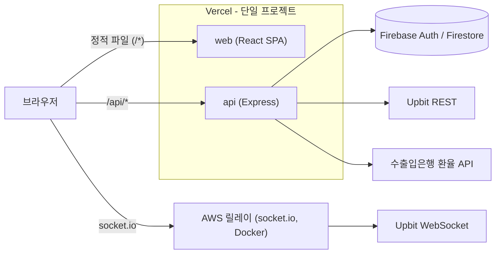

# CoinBrief

업비트 시세 기반 코인 대시보드. 관심 코인의 실시간 시세·차트, 코인 검색/랭킹, 환율 계산을 한 곳에서 봅니다.

- 배포: https://coinbrief.vercel.app
- 디자인: [Figma](https://www.figma.com/design/xxO2ItVjjcXe3QsYKTmkPR/coin_project?node-id=4-2&p=f&t=bnnTBeGYCcaMUDY6-0)
- 개인 프로젝트 (2025.01 첫 개발, 2026.11 Next.js → React SPA + Express 로 재구성)
- 이전 Next.js 버전: 태그 `v1-nextjs`, 브랜치 `legacy/nextjs`

## 주요 기능

- **내 코인** (최대 4개): 소켓 실시간 시세, 차트, 추가/삭제
- **코인리스트**: 검색, 거래대금 TOP3 / 하락 TOP3, 환율 계산기 (KRW ↔ USD)
- **코인 상세**: 캔들 차트, KRW/USD 전환
- **인증**: 회원가입(이메일 OTP), 로그인(이메일 / 구글 / 카카오), 비밀번호 찾기, 회원 탈퇴
- 다크 모드, 로딩 스켈레톤
- 비로그인 랜딩은 인기 코인 4개를 캐시된 REST 로만 보여줍니다 (웹소켓 없음)

## 아키텍처



| 폴더 | 역할 |
| --- | --- |
| `web/` | React 18 + Vite SPA |
| `api/` | Express 5 + TypeScript (routes → controllers → services) |
| `server/` | Upbit WebSocket 을 socket.io 로 중계하는 릴레이. Vercel 이 아닌 AWS 에 Docker 로 별도 배포 |
| `e2e/` | Playwright 스모크 테스트 |

`vercel.json` 의 Vercel Services 설정으로 한 프로젝트에 배포합니다: `/api/*` → `api`, 나머지 → `web` SPA.

## 기술 스택

- **Frontend**: React 18, TypeScript, Vite, react-router v7, TanStack Query v5, zustand, Tailwind CSS 3, react-hook-form, ApexCharts, socket.io-client, firebase (클라이언트, 지연 로딩)
- **Backend**: Express 5, firebase-admin 13, nodemailer (OTP 메일)
- **Infra / Test**: Vercel (Services), AWS + Docker (릴레이), Playwright

## 설계 결정

| 결정 | 이유 |
| --- | --- |
| Next.js → Vite SPA + Express | Next 를 거의 서버 라우트 용도로만 쓰고 있었고, SSR 과 sessionStorage 기반 로그인이 섞여 hydration 버그가 났음 |
| Vercel Services 단일 프로젝트 | web/api 를 원자적으로 배포하고, 같은 origin 이라 쿠키가 단순하고 CORS 가 필요 없음 |
| Firebase 세션 쿠키(5일) | ID 토큰은 1시간짜리라 refresh 토큰 처리가 필요함. 세션 쿠키(httpOnly)는 그 처리가 필요 없음 |
| axios 대신 fetch + 작은 `apiFetch` | 필요한 건 JSON 요청과 에러 메시지 처리뿐이라 의존성을 늘리지 않음 |
| 서버 상태는 TanStack Query, 클라이언트 상태는 zustand | 캐시/로딩/재요청은 Query 가, UI 상태만 zustand 가 맡도록 역할을 분리 |
| 랜딩은 캐시된 REST, 웹소켓 없음 | 비로그인 방문마다 릴레이(AWS) 연결을 만들지 않아 비용과 부하를 줄임 |
| Firebase 동적 import | 초기 경로에서 제거해 공통 청크 338kB → 6.5kB. 로그인 등 필요한 시점에 로드 |
| 로딩 스켈레톤 + 첫 화면 데이터 prefetch | 빈 화면/레이아웃 흔들림을 줄이고, React 렌더 전에 요청을 시작 |

### 보안 (PR #26, #28, #30)

- 비밀번호 변경은 OTP 인증 후 서버가 발급한 일회성 토큰이 있어야 가능
- 카카오 로그인은 클라이언트가 보낸 이메일을 믿지 않고, 서버가 카카오 API 로 직접 사용자 정보를 조회
- 코인 추가/삭제, 회원 탈퇴는 세션 확인 + 본인 확인
- OTP 메일 발송 제한: 이메일당 60초 1회 · 시간당 5회, IP당 시간당 20회 (서버리스라 Firestore 에 기록)
- OTP 검증 시도 5회 제한
- 회원가입은 서버가 발급한 이메일 소유 증명(`signupok` 쿠키)이 있어야 가능

## 로컬 실행

필요: Node 24 (`web/`, `api/` 의 `engines`), 릴레이 포함 3개 서버를 각각 실행합니다.

```bash
# 설치 (패키지별)
npm install                  # 루트: e2e (Playwright)
(cd web && npm install)
(cd api && npm install)
(cd server && npm install)

# 실행 (터미널 3개)
cd server && npm start       # 릴레이   :4000
cd api && npm run dev        # API      :4100
cd web && npm run dev        # 웹       :5173 (/api 는 :4100 으로 프록시)
```

### 환경변수

루트의 `.env` 하나를 web 과 api 가 읽고, `.env.local` 이 있으면 덮어씁니다 (둘 다 git 제외). 릴레이는 `server/.env` 를 읽습니다. 이름만 적습니다.

<details>
<summary>변수 이름 목록</summary>

**web (`VITE_*` 만 노출)**

- `VITE_FIREBASE_API_KEY`, `VITE_FIREBASE_AUTH_DOMAIN`, `VITE_FIREBASE_PROJECT_ID`, `VITE_FIREBASE_STORAGE_BUCKET`, `VITE_FIREBASE_MESSAGING_SENDER_ID`, `VITE_FIREBASE_APP_ID`, `VITE_FIREBASE_MEASUREMENT_ID`
- `VITE_KAKAO_API_KEY`, `VITE_KAKAO_TOKEN_URL`
- `VITE_WEBSOCKET_URL` (릴레이 주소), `VITE_IMAGE_URL` (코인 아이콘)
- `VITE_TEST_EMAIL`, `VITE_TEST_PW` (로그인 화면의 테스트 로그인 버튼용)
- (선택) `API_PROXY`: dev 서버의 `/api` 프록시 대상, 기본 `http://localhost:4100`

**api (서버 전용)**

- `FIREBASE_PROJECT_ID`, `FIREBASE_CLIENT_EMAIL`, `FIREBASE_PRIVATE_KEY`, `FIREBASE_API_KEY`
- `GMAIL_APP_EMAIL`, `GMAIL_APP_PASSWORD` (OTP 메일)
- `UPBIT_API_URL`
- `EXCHANGE_API_URL`, `EXCHANGE_API_KEY` (수출입은행 환율)
- (선택) `PORT` (기본 4100)

**릴레이 (`server/.env`)**

- (선택) `UPBIT_WEBSOCKET_URL` (기본 `wss://api.upbit.com/websocket/v1`), `PORT` 또는 `SERVER_PORT` (기본 4000)

</details>

### 테스트

```bash
npm run test:e2e             # 루트에서 실행
```

Playwright 스모크 테스트입니다. 데이터를 바꾸지 않는 읽기 전용 시나리오(랜딩, 헤더, 다크 모드, 로그인 → 내 코인 → 코인리스트 → 상세 → 로그아웃, 모바일 오버플로)이며, 위 3개 서버가 떠 있어야 하고 테스트 계정(`VITE_TEST_EMAIL` / `VITE_TEST_PW`)이 필요합니다. 기본 대상은 `http://localhost:5173`, `E2E_BASE_URL` 로 바꿀 수 있습니다.

## 폴더 구조

<details>
<summary>web/src, api/src</summary>

```
web/src
├── pages/        라우트 화면 (Landing, CoinList, DetailCoin, MyCoin, MyPage, auth/ ...)
├── coinlist/     코인리스트 구성요소 (검색, TOP3, 환율 계산기, 테이블)
├── components/   공통 UI (ui/, CustomUI/, DarkMode/, RequireAuth, Skeleton)
├── lib/          apiFetch, queries / mutations (TanStack Query), session, 차트 테마
├── store/        zustand 스토어
├── firebase/     Firebase 클라이언트 (동적 import)
├── type/         타입 정의
└── utill/        유틸 함수

api/src
├── app.ts / server.ts   Express 앱 / 로컬 서버 진입점
├── routes/              URL 매핑 (auth, coins, market, otp)
├── controllers/         요청/응답 처리
├── services/            비즈니스 로직 (auth, coins, otp, market, exchangeRate, popularCoins)
├── middlewares/         세션 검증
└── lib/                 firebase-admin 초기화, 쿠키/에러 헬퍼
```

</details>

## 커밋 컨벤션

`feat` 기능 추가·변경 / `fix` 버그 수정 / `perf` 성능 / `refactor` / `test` / `chore` / `docs`
